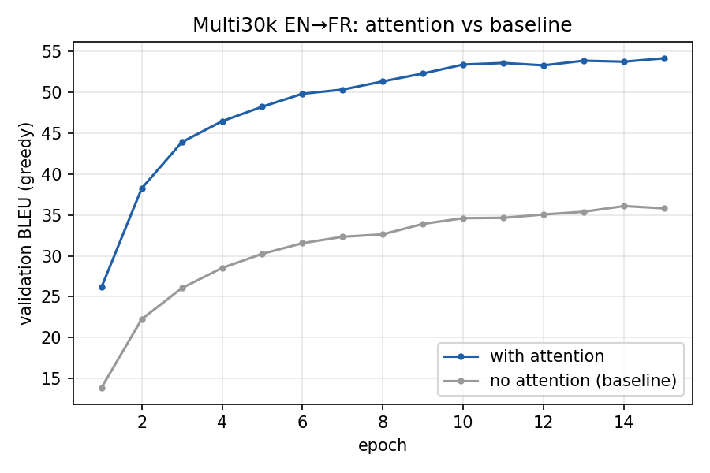
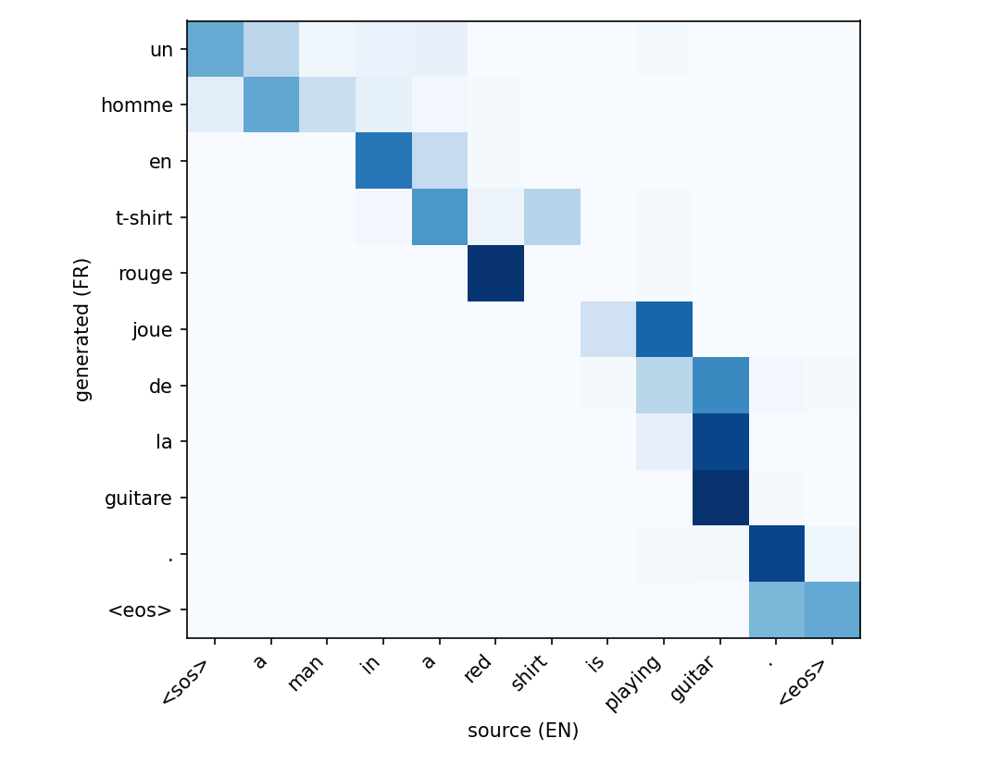

# Neural Machine Translation with Attention (EN → FR)

Bi-LSTM encoder + Bahdanau additive attention + LSTM decoder, trained on Multi30k English–French,
with attention heatmaps that show which English words each French word was generated from.

## Results (Multi30k Test 2016 Flickr, 1,000 sentences, beam = 5)

| Model | Test BLEU | Best val loss | Params |
|---|---|---|---|
| Rule-based word-by-word dictionary | **19.17** | – | 5,764-word dictionary |
| Seq2seq, no attention (baseline) | **40.65** | 2.579 | 15.7M |
| Seq2seq + Bahdanau attention | **56.76** | 2.208 | 16.0M |

Attention adds **+16.1 BLEU** over the plain seq2seq for only 0.3M extra parameters, and nearly triples
the rule-based score. Both neural models beat the proposal's 22–28 target; the rule-based one falls below it.
BLEU is NLTK corpus BLEU on lowercased, tokenized text, so it reads higher than detokenized sacreBLEU.



### Attention heatmap



"a man in a red shirt is playing guitar." → "un homme en t-shirt rouge joue de la guitare ."
The model handles the adjective–noun swap: *t-shirt* attends to *shirt*, *rouge* to *red*.
Some rows sit one word to the left of the source word they translate (e.g. *un* → `<sos>`).
This is a known trait of Bahdanau attention, which scores the source with the decoder state from
*before* the current word is fed in.

More heatmaps are in `outputs/`.

### Sample test translations (attention model)

| English | Reference | Prediction |
|---|---|---|
| A group of people standing in front of an igloo. | Un groupe de personnes debout devant un igloo. | un groupe de personnes debout devant un igloo . |
| People are fixing the roof of a house. | Des gens réparent le toit d'une maison. | des gens répare le toit d' une maison . |
| A man in an orange hat starring at something. | Un homme avec un chapeau orange regardant quelque chose. | un homme avec une casquette orange regardant quelque chose . |

Typical errors: rare words become `<unk>` (e.g. *snowmobiles*), occasional verb agreement (*répare*), and
long sentences can drop a clause.

### Rule-based vs neural, same sentence

| | Translation |
|---|---|
| English | A Boston Terrier is running on lush green grass in front of a white fence. |
| Reference | Un terrier de Boston court sur l'herbe verdoyante devant une clôture blanche. |
| Rule-based | un boston terrier est court sur luxuriante herbe vert en devant de un clôture blanc . |
| Attention | un terrier de court court sur l' herbe verte devant une clôture blanche . |

The rule-based system (`rule_based.py`) looks every word up in a dictionary extracted from the training
data (IBM Model 1, 5 EM iterations) and applies two hand-written rules: colour adjectives move after
their noun, and "'s" is dropped. It can't do gender agreement (*un clôture blanc*), translates
"is running" literally as *est court*, and keeps English order everywhere else. These are the
weaknesses listed on slide 3 of the proposal.

## Web demo

```bash
python app.py        # then open http://127.0.0.1:5000
```

Type an English sentence (or click **Random test sentence**) to see:
- all three systems' translations side by side, plus the human reference for test sentences
- an interactive attention heatmap; hover a cell to see the exact weight
- a warning listing words the model doesn't know, and a stronger warning when the input doesn't look like English

Bad input is handled with clear messages: empty text, no letters, over 300 characters or 60 words, a
non-numeric beam (other beams are clamped to 1–10), malformed requests, missing checkpoints (the page
names the command to run), and a stopped server.
The app was tested in a desktop browser and at phone width (375 px).

## Project layout

| File | Purpose |
|---|---|
| `data.py` | Downloads Multi30k EN/FR, tokenizes (lowercase, punctuation split), builds vocab (min freq 2 → `<unk>`), pads/batches |
| `model.py` | `Encoder` (Bi-LSTM), `BahdanauAttention`, `Decoder` (LSTM), `Seq2Seq` with greedy + beam search; `use_attention=False` = baseline |
| `train.py` | Teacher forcing, cross-entropy (label smoothing 0.1), Adam + ReduceLROnPlateau, grad clipping, per-epoch val BLEU |
| `evaluate.py` | Test-set BLEU with beam search + sample translations |
| `visualize.py` | Translate one sentence and save its attention heatmap |
| `rule_based.py` | Rule-based baseline: IBM-1 dictionary + reordering rules, test BLEU |
| `app.py`, `web/index.html` | Flask web demo (API + single-page frontend) |
| `plot_curves.py` | Validation-BLEU curves for both models from the training logs |
| `demo.ipynb` | Demo notebook: heatmaps for example sentences + test samples |

## Run

```bash
pip install -r requirements.txt
python train.py                     # attention model -> checkpoints/attention.pt  (~10 min on an RTX 4060)
python train.py --no-attention      # baseline       -> checkpoints/baseline.pt
python evaluate.py --ckpt checkpoints/attention.pt
python evaluate.py --ckpt checkpoints/baseline.pt
python rule_based.py                # rule-based baseline (builds its dictionary on first run)
python visualize.py "A man in a red shirt is playing guitar." --out outputs/guitar.png
python plot_curves.py
jupyter notebook demo.ipynb
```

Run one GPU job at a time; two processes sharing a laptop GPU can crash with a cuBLAS error.

## Data

Multi30k task 1 (Elliott et al., 2016), downloaded from the official repo (github.com/multi30k/dataset);
it's the same corpus as the Kaggle mirror `shahadhamza/multi30k-dataset`.
Train 29,000 / val 1,014 / test 1,000 pairs. Vocab: 5,979 EN, 6,486 FR words.

## Model details

- Embeddings 256, encoder Bi-LSTM 2×256, decoder LSTM 512, attention dim 256, dropout 0.3
- Attention: e_ij = vᵀ tanh(W s_{i−1} + U h_j), α_ij = softmax_j(e_ij), c_i = Σ_j α_ij h_j
- Baseline: same network, but the decoder gets one fixed context vector (mean of encoder states)
- 15 epochs, batch 128, lr 1e-3, gradient clip 1.0, beam 5 with length normalization
